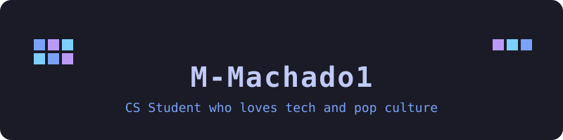
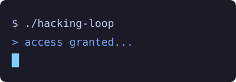
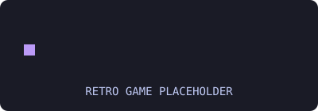

# Hi there 👋 I'm M-Machado1

<!-- Banner: local SVG, theme-agnostic palette -->
<picture>
  <source media="(prefers-color-scheme: dark)" srcset="assets/banner.svg">
  <source media="(prefers-color-scheme: light)" srcset="assets/banner.svg">
  
</picture>

<!-- Typing tagline: readme-typing-svg (DenverCoder1) -->

<!-- Divider: purple to cyan gradient SVG -->
<picture>
  <source media="(prefers-color-scheme: dark)" srcset="assets/divider.svg">
  <source media="(prefers-color-scheme: light)" srcset="assets/divider.svg">
  
</picture>

## 🛠️ Working on

A multitask terminal companion built with **TypeScript** and **Ink**.
[→ CLI-Companion](https://github.com/M-Machado1/CLI-Companion)

<!-- Animated placeholders (Section 13 moved here, side by side and compact) -->

  <picture>
    <source media="(prefers-color-scheme: dark)" srcset="assets/hacking-loop.svg">
    <source media="(prefers-color-scheme: light)" srcset="assets/hacking-loop.svg">
    
  </picture>
  <!-- TODO: replace assets/hacking-loop.svg with assets/hacking-loop.gif (real animated GIF). When swapping in a real GIF, update the file path from .svg to .gif above. -->
  <picture>
    <source media="(prefers-color-scheme: dark)" srcset="assets/retro-game.svg">
    <source media="(prefers-color-scheme: light)" srcset="assets/retro-game.svg">
    
  </picture>
  <!-- TODO: replace assets/retro-game.svg with assets/retro-game.gif (real animated GIF). When swapping in a real GIF, update the file path from .svg to .gif above. -->

## 🌱 Learning

Rust, TypeScript, React Native, Node.js, Ink, Tailwind.

## 🧰 Tech stack

Languages:

Frameworks and libraries:

Databases:

Tools:

<!-- Fallback: Insomnia has no confirmed skillicons.dev icon; using a Simple Icons badge via shields.io styled in the Tokyo Night palette. -->

<!-- Divider: purple to cyan gradient SVG -->
<picture>
  <source media="(prefers-color-scheme: dark)" srcset="assets/divider.svg">
  <source media="(prefers-color-scheme: light)" srcset="assets/divider.svg">
  
</picture>

## 📊 GitHub stats

  <a href="https://github.com/M-Machado1">
    <picture>
      <source media="(prefers-color-scheme: dark)" srcset="https://github-readme-stats.vercel.app/api?username=M-Machado1&theme=tokyonight&show_icons=true&hide=issues,prs">
      <source media="(prefers-color-scheme: light)" srcset="https://github-readme-stats.vercel.app/api?username=M-Machado1&theme=default&show_icons=true&hide=issues,prs">
      
    </picture>
  </a>
  <a href="https://github.com/M-Machado1">
    <picture>
      <source media="(prefers-color-scheme: dark)" srcset="https://github-readme-stats.vercel.app/api/top-langs?username=M-Machado1&theme=tokyonight&layout=compact&langs_count=8">
      <source media="(prefers-color-scheme: light)" srcset="https://github-readme-stats.vercel.app/api/top-langs?username=M-Machado1&theme=default&layout=compact&langs_count=8">
      
    </picture>
  </a>

<!-- Note: stats cards use the public github-readme-stats instance, which is best-effort and rate-limited (default cache ~24h stats / ~144h top langs). For reliable cards, self-host or generate via GitHub Actions; public instance serves public repos only and needs no token. -->

<!-- Profile Summary Cards (tokyonight): generated by .github/workflows/profile-cards.yml into profile-summary-card-output/tokyonight/ -->

  
  
  
  

<!-- These cards are generated by the profile-cards workflow and will be missing until it runs for the first time. -->

<!-- Divider: purple to cyan gradient SVG -->
<picture>
  <source media="(prefers-color-scheme: dark)" srcset="assets/divider.svg">
  <source media="(prefers-color-scheme: light)" srcset="assets/divider.svg">
  
</picture>

## 👾 Pac-Man contribution graph

<picture>
  <source media="(prefers-color-scheme: dark)" srcset="https://raw.githubusercontent.com/M-Machado1/M-Machado1/output/pacman-contribution-graph-dark.svg">
  <source media="(prefers-color-scheme: light)" srcset="https://raw.githubusercontent.com/M-Machado1/M-Machado1/output/pacman-contribution-graph.svg">
  
</picture>
<!-- Generated daily by .github/workflows/pacman.yml; pushes SVGs to the `output` branch. Missing until the workflow runs for the first time. -->

## 💬 Random quote & dev joke

  
  

<!-- Quote card uses the closest available Tokyo Night look (dark theme); the quotes API does not expose a tokyonight theme. Joke card uses theme=tokyonight. -->

## 🔗 Links

- [CLI-Companion](https://github.com/M-Machado1/CLI-Companion) — Multitask terminal companion (TypeScript + Ink)

<!-- Social badges placeholder (none added per spec) -->
<!--

  
  
  

-->
