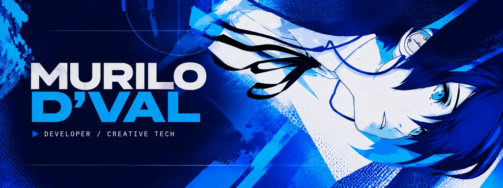

# Hi there 👋 I'm MURILO D'VAL

## Developer in the making, in love with pop culture, with a knack for making memorable things.

I turn ideas into tangible things — combining technical curiosity, creative expression, and attention to detail.

## 🛠️ Selected work

**CLI Companion** — a terminal companion designed to bring personality and playful interactions into existing shell environments. Planning/design stage.

[→ CLI-Companion](https://github.com/M-Machado1/CLI-Companion)

## 🧰 Technical interests

**Using**
TypeScript, Node.js, Ink, Tailwind CSS

**Exploring**
Rust, Python, React Native, Flask, MySQL, SQLite

## 🔗 Links

- [CLI-Companion](https://github.com/M-Machado1/CLI-Companion) — Multitask terminal companion (planning/design stage)
